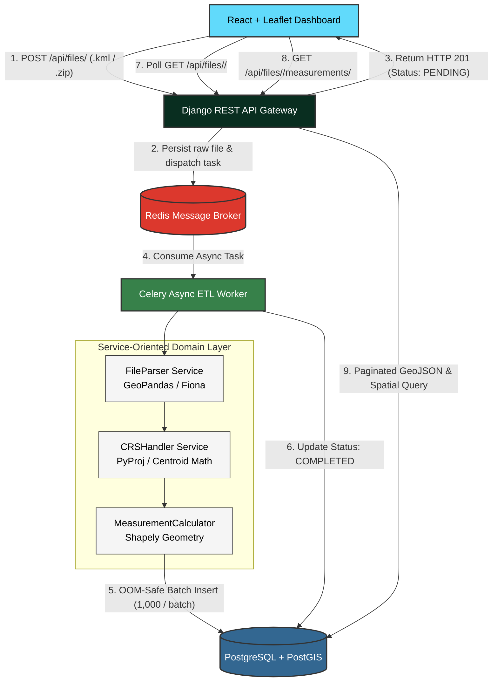

# Geospatial Intelligence Pipeline


An enterprise-grade, asynchronous Geospatial File Measurement and Analytics ETL Engine. Built to ingest complex geographical vector data (ESRI Shapefiles and Keyhole Markup Language - KML), dynamically project coordinate reference systems to localized metric grids (UTM), and calculate high-precision physical measurements (Polygon Area in square meters, LineString Length in meters, and graceful Point inspection).

---

## Live Links and Demo

- **Interactive Dashboard:** [https://geo-spatial-navy.vercel.app/](https://geo-spatial-navy.vercel.app/)
- **Live Backend API Gateway:** [http://43.204.218.157:8000/api/files/](http://43.204.218.157:8000/api/files/)
- **GitHub Repository:** [https://github.com/PrashanthHosamani/GeoSpatial](https://github.com/PrashanthHosamani/GeoSpatial)
- **Architecture & System Walkthrough:** [assets/demo_walkthrough.mp4](./assets/demo_walkthrough.mp4)

---

## System Walkthrough Video

https://github.com/user-attachments/assets/demo_walkthrough.mp4

> **Direct File:** The demo video is also committed directly in this repository at [`assets/demo_walkthrough.mp4`](./assets/demo_walkthrough.mp4).

<video src="assets/demo_walkthrough.mp4" controls="controls" width="100%" style="border-radius: 8px; box-shadow: 0 4px 12px rgba(0,0,0,0.15);"></video>

---

## Problem Statement and Scope

Modern drone platforms and geospatial intelligence systems capture vector surveying data across various geographic coordinate spaces. Computing accurate physical metrics (such as the surface area of mining excavation pits, land parcels, or lengths of pipeline and river networks) directly from raw GPS coordinates (latitude/longitude in degrees) introduces severe geometric distortion. 

This service addresses this challenge by providing:
1. **Multi-Format Ingestion:** Accepts zipped ESRI Shapefiles (`.zip` containing `.shp`, `.shx`, `.dbf`, `.prj`) and Keyhole Markup Language (`.kml`) files.
2. **Robust Feature Extraction:** Streams features, extracts metadata attributes, geometries, and identifies native Coordinate Reference Systems (CRS).
3. **Dynamic Metric Re-projection:** Dynamically calculates feature centroids and reprojects geographical coordinates (`EPSG:4326`) into optimal localized Universal Transverse Mercator (UTM) metric grids.
4. **Accurate Geometric Measurements:** Computes planar Area in square meters ($\text{m}^2$) for Polygons, Length in meters ($\text{m}$) for LineStrings, and handles Points and unsupported shapes gracefully without service failure.
5. **Non-Blocking Architecture:** Decouples file uploads from heavy spatial math using Celery workers and Redis queues to eliminate HTTP gateway timeouts.

---

## End-to-End Architecture



### Application Structure
```text
geo-measure-api/
├── assets/                       # Demo walkthrough video and media assets
│   └── demo_walkthrough.mp4
├── backend/                      # Django Core & GeoSpatial Application
│   ├── config/                   # Project settings, Celery app, WSGI/ASGI
│   ├── geo_spatial/              # Core Geospatial Application
│   │   ├── models.py             # GeoFile and Feature (PostGIS GeometryField) models
│   │   ├── views.py              # API ViewSets (Upload, Status, Measurements)
│   │   ├── serializers.py        # Model & GeoJSON serializers
│   │   ├── tasks.py              # Celery async ETL task pipeline
│   │   ├── urls.py               # API route definitions
│   │   └── services/             # Clean Domain Services (Decoupled Logic)
│   │       ├── file_parser.py    # Multi-format reader (Shapefile .zip, KML layers)
│   │       ├── crs_handler.py    # Centroid math & dynamic UTM projection engine
│   │       └── measurement.py    # Planar geometry measurement engine
│   ├── Dockerfile                # Multi-stage image with GDAL / GEOS system libs
│   └── requirements.txt
├── docker-compose.yml            # Orchestrates Web, Celery, PostGIS, and Redis
├── frontend/                     # React 18 + Vite + Leaflet mapping UI
│   ├── src/
│   │   ├── components/           # Upload zone, Map viewer, Measurement inspector
│   │   └── App.jsx
│   └── vercel.json               # Reverse proxy routing to AWS EC2 backend
└── test_data/                    # Sample validation datasets (KML & Shapefile)
    ├── river.kml
    └── real_rivers.zip
```

---

## Processing and Measurement Flow

### 1. File Ingestion Flow
1. **Validation:** The endpoint checks file extensions (`.zip`, `.kml`) and verifies Shapefile internal components (`.shp`, `.shx`, `.dbf`).
2. **Immediate Acknowledgment:** The file is saved to storage, an initial `GeoFile` record is created with status `PENDING`, and a task is enqueued to Redis. The API immediately responds with the unique `file_id`.
3. **Background Worker Execution:** Celery takes the task, creates an isolated temporary directory, unzips/parses the payload with Fiona/GeoPandas, and extracts native features.

### 2. CRS Handling and Dynamic UTM Engine
- **The Problem with Geographic CRS (`EPSG:4326`):** Coordinates in `EPSG:4326` represent angles (degrees of latitude and longitude) on a three-dimensional ellipsoid. Because meridians converge at the poles, one degree of longitude spans ~111 km at the equator but shrinks to 0 km at the poles. Calculating polygon area directly on latitude/longitude coordinates produces meaningless values in square degrees.
- **Dynamic Centroid Calculation:** Rather than relying on static configurations or hardcoded projections, our `CRSHandler` computes the collective geometric centroid of all ingested features:
  $$\text{Centroid} = (\bar{x}_{\text{lon}}, \bar{y}_{\text{lat}})$$
  The mathematically optimal UTM zone is resolved using:
  $$\text{UTM Zone} = \left\lfloor \frac{\bar{x}_{\text{lon}} + 180}{6} \right\rfloor + 1$$
  $$\text{EPSG Code} = \begin{cases} 32600 + \text{UTM Zone} & \text{if } \bar{y}_{\text{lat}} \ge 0 \text{ (Northern Hemisphere)} \\ 32700 + \text{UTM Zone} & \text{if } \bar{y}_{\text{lat}} < 0 \text{ (Southern Hemisphere)} \end{cases}$$
- The coordinates are transformed via PyProj to this localized planar grid where 1 unit = 1 meter, ensuring area and distance distortion remain negligible (< 0.04%).

### 3. Measurement Calculation Flow
- **Polygons and MultiPolygons:** Area is calculated in square meters ($\text{m}^2$) over the projected plane.
- **LineStrings and MultiLineStrings:** Length is calculated in meters ($\text{m}$).
- **Points and MultiPoints:** Points possess zero area and zero length; the engine gracefully sets `area_sqm = None` and `length_m = None`.
- **Unsupported and Unknown Geometries:** Processed gracefully with attributes and geometries preserved, logging warnings without failing the entire batch.

---

## Design Decisions and Alternatives Considered

| Decision | Selected Approach | Alternatives Considered | Rationale and Trade-offs |
|---|---|---|---|
| **Backend Framework** | **Django + DRF + GeoDjango** | FastAPI + GeoAlchemy2 | FastAPI is lightweight, but lacks native geospatial ORM bindings. Connecting PostGIS requires manual glue code (`GeoAlchemy2`, `Shapely`, custom GeoJSON serializers). GeoDjango provides battle-tested spatial queries, automatic PostGIS integration, and native spatial models with zero boilerplate. |
| **Execution Model** | **Asynchronous Task Queue (Celery + Redis)** | Synchronous In-Request Processing | Processing large files (e.g. 70MB Shapefiles with 30,000+ features) takes 15–45 seconds. Synchronous processing blocks web worker threads and triggers `504 Gateway Timeout` errors. Celery ensures the API responds in `<150ms` while worker pools handle heavy math in the background. |
| **Projection Strategy** | **Dynamic Centroid UTM (EPSG:326xx / 327xx)** | Fixed Web Mercator (`EPSG:3857`) or Haversine | Web Mercator severely inflates area away from the equator (e.g., Greenland appears larger than Africa). Haversine only computes point-to-point distances and cannot measure multi-ring polygon areas. Centroid-derived UTM preserves conformal area and planar length with under 0.04% scale distortion. |
| **Spatial Database** | **PostgreSQL + PostGIS** | SQLite (SpatiaLite) or In-Memory (Shapely only) | Pure in-memory processing does not persist data for subsequent queries. SQLite/SpatiaLite struggles with high concurrent write loads. PostGIS is the drone and geospatial industry standard, offering robust spatial indexing (`GiST`), binary WKB loading, and spatial SQL scalability. |
| **Database Insertion** | **Chunked `bulk_create` (1,000 items) + `.wkb_hex`** | Single row inserts or Full-table dump | Single `INSERT` queries for 30,000 records take minutes. Inserting all 30,000 records in one single statement spikes memory and risks OOM crashes. Streaming in 1,000-record chunks with Well-Known Binary (`.wkb_hex`) strings maintains flat RAM consumption and delivers a 5-10x throughput speedup. |

---

## API Documentation and Example Requests and Responses

### 1. Upload Geospatial File
Accepts a zipped Shapefile (`.zip`) or Keyhole Markup Language (`.kml`) file.

- **Endpoint:** `POST /api/files/`
- **Content-Type:** `multipart/form-data`

#### Example Request:
```bash
curl -X POST http://43.204.218.157:8000/api/files/ \
  -F "file=@test_data/real_rivers.zip"
```

#### Example Response (`201 Created`):
```json
{
  "id": "e2a1b94c-83fd-44c6-b519-72c67de21d09",
  "filename": "real_rivers.zip",
  "file": "http://43.204.218.157:8000/media/uploads/real_rivers.zip",
  "original_crs": null,
  "feature_count": 0,
  "status": "PENDING",
  "error_message": null,
  "uploaded_at": "2026-10-10T14:32:00.124510Z",
  "processed_at": null
}
```

---

### 2. Check File Processing Status
Retrieves current processing progress, feature count, detected CRS, and execution timestamps.

- **Endpoint:** `GET /api/files/{id}/`

#### Example Request:
```bash
curl -X GET http://43.204.218.157:8000/api/files/e2a1b94c-83fd-44c6-b519-72c67de21d09/
```

#### Example Response (`200 OK` - Completed):
```json
{
  "id": "e2a1b94c-83fd-44c6-b519-72c67de21d09",
  "filename": "real_rivers.zip",
  "file": "http://43.204.218.157:8000/media/uploads/real_rivers.zip",
  "original_crs": "EPSG:4326",
  "feature_count": 13,
  "status": "COMPLETED",
  "error_message": null,
  "uploaded_at": "2026-10-10T14:32:00.124510Z",
  "processed_at": "2026-10-10T14:32:04.891230Z"
}
```

---

### 3. Fetch Measurements and GeoJSON Features
Returns paginated spatial features with extracted properties, geometries, and calculated physical measurements.

- **Endpoint:** `GET /api/files/{id}/measurements/`
- **Query Parameters:** `?page=1&page_size=10`

#### Example Request:
```bash
curl -X GET "http://43.204.218.157:8000/api/files/e2a1b94c-83fd-44c6-b519-72c67de21d09/measurements/?page=1"
```

#### Example Response (`200 OK` - Paginated FeatureCollection):
```json
{
  "type": "FeatureCollection",
  "count": 13,
  "next": null,
  "previous": null,
  "features": [
    {
      "type": "Feature",
      "id": "7b8f3a12-87ad-45ce-8261-2495b45cba01",
      "geometry": {
        "type": "LineString",
        "coordinates": [
          [77.5946, 12.9716],
          [77.6012, 12.9805],
          [77.6150, 12.9912]
        ]
      },
      "properties": {
        "feature_index": 0,
        "geometry_type": "LineString",
        "length_m": 4821.54,
        "area_sqm": null,
        "projected_crs": "EPSG:32643",
        "attributes": {
          "name": "Cauvery Feeder Canal",
          "stream_order": 3,
          "category": "Perennial"
        }
      }
    },
    {
      "type": "Feature",
      "id": "9c1e4d56-42bc-41de-9190-6712a14ef289",
      "geometry": {
        "type": "Polygon",
        "coordinates": [
          [
            [77.5900, 12.9700],
            [77.6100, 12.9700],
            [77.6100, 12.9900],
            [77.5900, 12.9900],
            [77.5900, 12.9700]
          ]
        ]
      },
      "properties": {
        "feature_index": 1,
        "geometry_type": "Polygon",
        "area_sqm": 245120.75,
        "length_m": null,
        "projected_crs": "EPSG:32643",
        "attributes": {
          "name": "Mining Reservoir Zone A",
          "depth_avg_m": 14.2
        }
      }
    }
  ]
}
```

---

## Setup and Running Locally

### Option A: Docker Compose (Recommended)
No local installation of GDAL, PostGIS, or Redis required.

1. **Clone the repository:**
   ```bash
   git clone https://github.com/PrashanthHosamani/GeoSpatial.git
   cd GeoSpatial
   ```

2. **Spin up all services in daemon mode:**
   ```bash
   docker-compose up -d --build
   ```

3. **Verify running containers:**
   ```bash
   docker-compose ps
   ```

4. **Access the Application:**
   - **Frontend UI:** [http://localhost:5173](http://localhost:5173)
   - **Backend API Gateway:** [http://localhost:8000](http://localhost:8000)
   - **Django Admin Panel:** [http://localhost:8000/admin/](http://localhost:8000/admin/)

---

### Option B: Local Python Development Setup

#### Prerequisites
- Python 3.11+
- PostgreSQL 15+ with PostGIS extension enabled
- Redis Server (`brew install redis` or `sudo apt install redis-server`)
- GDAL & GEOS C-libraries (`brew install gdal` or `sudo apt install libgdal-dev`)

#### 1. Backend Setup
```bash
cd backend

# Create and activate virtual environment
python3 -m venv env
source env/bin/activate  # On Windows: env\Scripts\activate

# Install dependencies
pip install -r requirements.txt

# Configure environment variables (.env)
cp .env.example .env

# Run database migrations
python manage.py migrate

# Start Redis
redis-server &

# In a separate terminal, start the Celery worker
celery -A config worker --loglevel=info

# In another terminal, start the Django development server
python manage.py runserver 0.0.0.0:8000
```

#### 2. Frontend Setup
```bash
cd frontend

# Install Node dependencies
npm install

# Start Vite development server
npm run dev
```

---

## Testing with Provided Datasets

The repository includes curated vector datasets inside [`test_data/`](./test_data/):

1. **[`test_data/river.kml`](./test_data/river.kml):** A clean Keyhole Markup Language file representing a single watercourse line geometry. Ideal for testing instant XML parsing and metric length computation.
2. **[`test_data/real_rivers.zip`](./test_data/real_rivers.zip):** A multi-feature ESRI Shapefile bundle containing 13 river paths. Demonstrates zip extraction, Shapefile header detection, centroid UTM re-projection, and bulk database batching.

---

## Key Learnings

1. **Geodetic vs. Projected Spatial Systems:** Gained deep mathematical understanding of why angular geographic systems (`EPSG:4326`) cannot be treated as planar surfaces. Implementing dynamic UTM zone selection solidified practical expertise in coordinate systems and ellipsoidal geometry.
2. **ESRI Shapefile Architecture & Binary Formats:** Learned the low-level structure of ESRI bundles (`.shp` geometries, `.shx` indices, `.dbf` dBase tables, `.prj` projection parameters) and parsing them through streaming GDAL/Fiona drivers.
3. **High-Throughput ETL Optimization:** Solved real-world memory pressure by avoiding naive full-file in-memory dumps. Using Well-Known Binary (`.wkb_hex`) serialization combined with chunked 1,000-record database batches ensured constant flat RAM consumption during large data imports.
4. **Resilient Asynchronous System Design:** Architected non-blocking task orchestration using Celery and Redis to decouple heavy geospatial CPU workloads from REST API request cycles.
5. **Production Cloud Deployment & Security:** Successfully deployed a multi-container architecture onto AWS EC2 with PostGIS and managed mixed-content SSL security via Vercel proxy rewrite rules.

---

## Future Scope

1. **Support for 3D Raster & Elevation Data:** Extend the ETL pipeline to ingest drone GeoTIFF orthomosaics and Digital Elevation Models (DEM/DSM) for volume calculation (e.g. stockpile excavation volumes).
2. **Real-time WebSocket Progress Streaming:** Implement Django Channels / WebSockets to stream granular progress (e.g., *"Parsed 1,500 of 10,000 features (15%)"*) directly to the frontend.
3. **Direct Cloud Storage Ingestion (S3 Presigned URLs):** Enable client-side direct uploads to Amazon S3 buckets, completely bypassing the application server's local disk I/O.
4. **Spatial Intersection & Buffer Queries:** Introduce spatial analytical endpoints (e.g., calculating safety buffers around power lines or detecting overlaps between multiple mining licenses).

