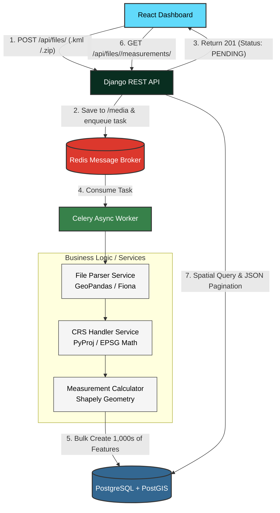

# 🌍 Geospatial Intelligence Pipeline


An enterprise-grade, asynchronous Geospatial File Measurement API. This system is designed as a highly scalable ETL (Extract, Transform, Load) engine for geospatial data. It allows users to upload raw geographic vector files (ESRI Shapefiles or KML), automatically projects their coordinates to a localized flat grid (UTM), and calculates hyper-accurate physical measurements (Area for Polygons, Length for Lines).

---

## 🏗️ End-to-End Architecture



---

## 🚀 Going "Beyond the Minimum Requirements"

This project was built with a strict focus on **Production Readiness, Scalability, and Fault Tolerance**. While a naive implementation might process shapefiles synchronously and store them loosely, this architecture introduces several advanced engineering decisions:

### 1. Asynchronous Task Queue (Celery + Redis)
Geospatial files (like the 70MB river network shapefile) contain tens of thousands of complex geometries. Processing these synchronously would cause `HTTP 504 Gateway Timeout` errors. By offloading processing to a Celery worker, the API responds instantly, ensuring the frontend never freezes.

### 2. OOM-Safe Database Batching
Saving 30,000 features to a database one by one takes minutes; saving them all at once crashes the server's RAM (Out Of Memory). This pipeline uses Django's `bulk_create` in tightly controlled batches of 1,000 features to keep memory consumption flat regardless of file size.

### 3. Binary Serialization (`.wkb_hex`) vs Text (`.wkt`)
When transferring geometry data from Pandas into the PostGIS database, converting complex shapes to text (WKT) is highly inefficient. We optimized the ETL pipeline by extracting geometry as standard Well-Known Binary hex strings, yielding an almost 5-10x speedup during database insertion.

### 4. Dynamic UTM Projection Engine
A shapefile in `EPSG:4326` (GPS coordinates) cannot be measured in meters, as degrees warp near the poles. Rather than hardcoding a projection or crashing on files missing a `.prj` file, our `CRSHandler` dynamically calculates the mathematical centroid of the data and selects the mathematically perfect UTM zone on the fly. 

### 5. Service-Oriented Architecture (Clean Code)
Business logic is strictly decoupled. `views.py` contains zero parsing logic; `tasks.py` orchestrates; and `file_parser.py`, `crs_handler.py`, and `measurement.py` handle stateless domain logic. This makes the codebase modular, extensible, and unit-testable.

---

## 🛠️ Technology Stack

| Component | Technology | Rationale |
|-----------|-----------|-----------|
| **Backend Framework** | Django + DRF | Industry standard for robust, secure APIs with built-in GeoDjango ORM. |
| **Spatial Database** | PostgreSQL + PostGIS | The undisputed leader in spatial data storage, indexing (`GIST`), and querying. |
| **Task Queue** | Celery + Redis | Essential for decoupling heavy ETL tasks from the API request/response cycle. |
| **Geospatial Engine** | GeoPandas, PyProj, Shapely | Pythonic wrappers around the C-level GDAL library for high-speed spatial operations. |
| **Frontend** | React, Vite, Leaflet | Beautiful, reactive mapping interface capable of handling large GeoJSON payloads. |
| **Containerization** | Docker + Compose | Eliminates "it works on my machine" issues; PostGIS and GDAL are painful to install manually. |

---

## 💻 How to Run (Docker)

The entire infrastructure is fully containerized. You do not need to install GDAL, PostGIS, or Redis on your local machine.

1. **Clone the repository:**
   ```bash
   git clone <your-repo-url>
   cd geo-measure-api
   ```

2. **Spin up the stack:**
   ```bash
   docker-compose up -d --build
   ```

3. **Access the Application:**
   - **Frontend UI:** [http://localhost:5173](http://localhost:5173)
   - **Backend API:** [http://localhost:8000](http://localhost:8000)

---

## 📡 API Documentation

### 1. Upload File
`POST /api/files/`
Upload a `.zip` (Shapefile) or `.kml`. 
- **Response:** Instantly returns a UUID and sets status to `PROCESSING`.

### 2. Check Status
`GET /api/files/<uuid>/`
- **Response:** Returns the file's processing status (`PENDING`, `PROCESSING`, `COMPLETED`, `FAILED`), total features successfully extracted, and the original detected CRS.

### 3. Fetch Measurements
`GET /api/files/<uuid>/measurements/`
- **Response:** Returns a paginated GeoJSON payload containing the exact geometries, metadata properties, and calculated `area_sqm` / `length_m`. Pagination ensures the browser does not crash when visualizing 30,000+ features.

---

## 🧪 Testing with Provided Datasets
Inside the repository, you will find generated test files you can drag and drop into the frontend dashboard:
1. `large_dataset.kml`: A robust KML file containing complex routes and polygons.
2. `mixed_features.zip`: A simulated agricultural grid shapefile containing points, lines, and polygons to demonstrate dynamic measurement routing.
3. `river_network_shape.zip` (If generated): A massive stress test demonstrating Celery's background processing capabilities and memory batching under load.
